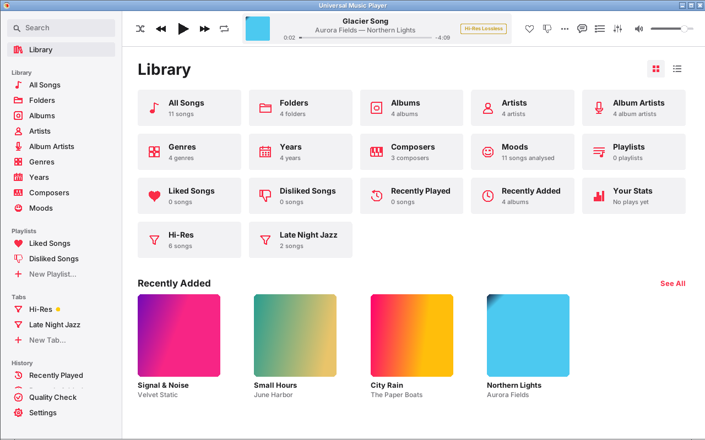
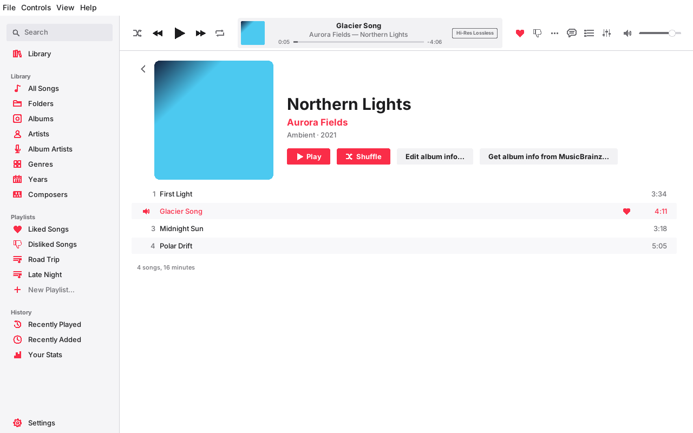
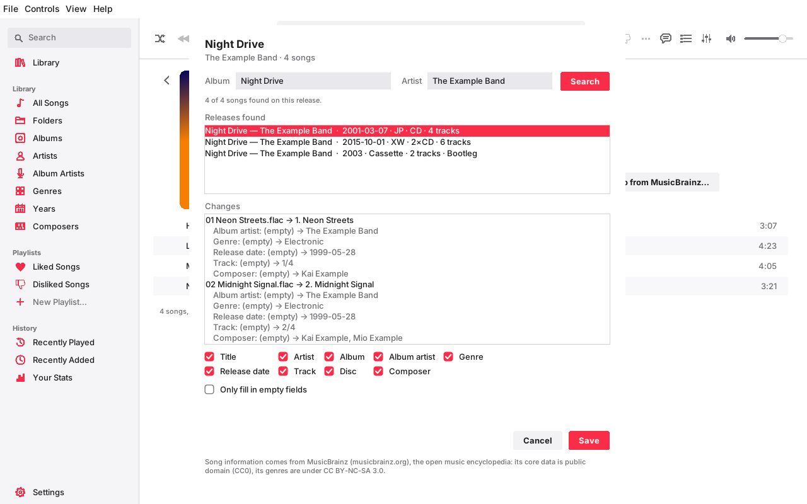
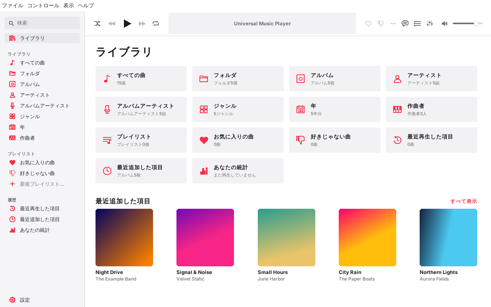

# Universal Music Player

Universal Music Player (formerly Real-Hi-Res) is a music player that also checks your music. Since version 2.0 the desktop app plays your library in an Apple Music-like window: a Library page with your songs, folders, albums, artists, album artists, genres, years, composers, playlists, liked and disliked songs, recently played and added music and "Your Stats", synced lyrics next to the cover, a graphic and a parametric equalizer with presets you can name, import and export, gapless playback, and themes you can make yourself. Since 2.1 it speaks English and Japanese (日本語), and it can fill in your songs' information (album, album artist, release date, track numbers, genre, composer) from MusicBrainz, by hand or automatically. Its quality checker, Real-Hi-Res, also available as a command-line tool, tells you which files are genuine and which ones are fakes. The rest of this page calls the quality checker by that name. It finds two kinds of fake. The first is **fake hi-res**: files whose container advertises something like 24-bit/96 kHz or 24-bit/192 kHz while the audio inside came from a CD-quality or 48 kHz master, or from a 16-bit master padded with zeros. The second is **fake lossless**, often called a "fake FLAC": FLAC, ALAC, WAV, AIFF or similar files, at any resolution, that were made by converting an MP3 or AAC file and therefore are not really lossless. The tool does not trust tags or file headers. It decodes the audio and checks the sample data itself against what the claimed format should contain. It can also download **synced lyrics** for your songs from [LRCLIB](https://lrclib.net) and save them as `.lrc` files next to them, the way [LRCGET](https://github.com/tranxuanthang/lrcget) does.


## Download and run (no installation needed)

Ready-to-run packages are attached to every release on the [Releases page](https://github.com/SU2H1/Universal-Music-Player/releases/latest). Python, NumPy and FFmpeg are bundled inside, so you only download, unpack and start it. Every file name carries the version, for example `UniversalMusicPlayer-1.10.0-windows-x64.zip`; `<version>` in the table below stands for it.

| System | Download | Start the app | Command line |
| --- | --- | --- | --- |
| Windows 10/11, 64-bit | `UniversalMusicPlayer-<version>-windows-x64.zip` | `UniversalMusicPlayer\UniversalMusicPlayer.exe` | `UniversalMusicPlayer\realhires-cli.exe "D:\Music"` |
| macOS 12 Monterey or later, Apple Silicon (M1 and later) | `UniversalMusicPlayer-<version>-macos-arm64.dmg` (or `.zip`) | `UniversalMusicPlayer.app` | `/Applications/UniversalMusicPlayer.app/Contents/MacOS/realhires-cli ~/Music` |
| macOS 10.15 Catalina or later, Intel | `UniversalMusicPlayer-<version>-macos-x86_64.dmg` (or `.zip`) | `UniversalMusicPlayer.app` | `/Applications/UniversalMusicPlayer.app/Contents/MacOS/realhires-cli ~/Music` |
| Linux, x86-64 (PC) | `UniversalMusicPlayer-<version>-linux-x64.tar.gz` | `UniversalMusicPlayer/UniversalMusicPlayer` | `UniversalMusicPlayer/realhires-cli ~/Music` |
| Linux, ARM64 (Raspberry Pi 4/5 with 64-bit OS, ARM laptops and servers) | `UniversalMusicPlayer-<version>-linux-arm64.tar.gz` | `UniversalMusicPlayer/UniversalMusicPlayer` | `UniversalMusicPlayer/realhires-cli ~/Music` |

**Rust version (preview).** Since 1.12.0 every release also carries the [Rust version](#rust-version-preview) of the app and the command-line tool, with FFmpeg bundled. It finds the same fakes with the same reasons and shares its settings and saved results with the version above.

| System | Download | Start the app | Command line |
| --- | --- | --- | --- |
| Windows 10/11, 64-bit | `UniversalMusicPlayer-Rust-<version>-windows-x64.zip` | `UniversalMusicPlayer-Rust\universal-music-player.exe` | `UniversalMusicPlayer-Rust\realhires.exe "D:\Music"` |
| macOS 12+, Apple Silicon | `UniversalMusicPlayer-Rust-<version>-macos-arm64.dmg` (or `.zip`) | `UniversalMusicPlayer-Rust.app` | `/Applications/UniversalMusicPlayer-Rust.app/Contents/MacOS/realhires ~/Music` |
| macOS 10.15+, Intel | `UniversalMusicPlayer-Rust-<version>-macos-x86_64.dmg` (or `.zip`) | `UniversalMusicPlayer-Rust.app` | `/Applications/UniversalMusicPlayer-Rust.app/Contents/MacOS/realhires ~/Music` |
| Linux, x86-64 | `UniversalMusicPlayer-Rust-<version>-linux-x64.tar.gz` | `UniversalMusicPlayer-Rust/universal-music-player` | `UniversalMusicPlayer-Rust/realhires ~/Music` |
| Linux, ARM64 | `UniversalMusicPlayer-Rust-<version>-linux-arm64.tar.gz` | `UniversalMusicPlayer-Rust/universal-music-player` | `UniversalMusicPlayer-Rust/realhires ~/Music` |

The first launch works as described below for the other packages (on macOS the app is called `UniversalMusicPlayer-Rust.app`). On Linux, `UniversalMusicPlayer-Rust/install.sh` adds "Real-Hi-Res (Rust)" to the application menu and links the command-line tool as `realhires-rust`, next to an installed Python version; the app also needs OpenGL, which every desktop has. On Windows, keep the `ffmpeg` folder next to the two programs.

If you are not sure which Mac you have, open the Apple menu and choose **About This Mac**. "Chip: Apple M…" means Apple Silicon, and "Processor: Intel…" means Intel. On Linux, `uname -m` prints `x86_64` for the x64 package or `aarch64` for the ARM64 package.

### macOS

Open the `.dmg` and drag **UniversalMusicPlayer** into **Applications**. The app is not signed with an Apple Developer ID, so the first launch is blocked with a message that the app "is damaged" or "cannot be opened". On macOS 15 Sequoia and later, open **System Settings → Privacy & Security**, scroll down, and click **Open Anyway** next to the UniversalMusicPlayer message. On older versions, right-click the app and choose **Open**. Alternatively, this Terminal command works on every version:

```bash
xattr -dr com.apple.quarantine /Applications/UniversalMusicPlayer.app
```

### Linux

The Linux packages are built on glibc 2.28. They therefore run on practically every distribution from 2018 onwards, including Ubuntu 18.10+, Debian 10+, Linux Mint 20+, Fedora 29+, RHEL/Rocky/AlmaLinux 8+, openSUSE Leap 15.3+, Arch and Manjaro. The app needs a graphical desktop (X11, or Wayland with XWayland, which every mainstream desktop provides). The command-line tool runs anywhere, including on servers. Unpack the archive wherever you like to keep the app:

```bash
tar -xzf UniversalMusicPlayer-*-linux-x64.tar.gz
```

Then optionally add Real-Hi-Res to your application menu and put `realhires-cli` on your `PATH` (in `~/.local/bin`). This installs for your user only and needs no root:

```bash
UniversalMusicPlayer/install.sh
```

The app keeps running from the unpacked folder, so run `install.sh` again if you move the folder, and run `UniversalMusicPlayer/uninstall.sh` to remove the menu entry.

### Windows

Unzip the archive and double-click `UniversalMusicPlayer.exe`. The app is not code-signed, so SmartScreen may show "Windows protected your PC" the first time. Continue with **More info → Run anyway**. Keep the whole `RealHiRes` folder together: `UniversalMusicPlayer.exe` and `realhires-cli.exe` are small launchers, and the program itself is in `UniversalMusicPlayer.pkg`, `realhires-cli.pkg` and the `_internal` folder next to them. `realhires-cli.exe` is the command-line tool for a terminal; if you double-click it, it opens the app (since 1.12.1), and so does the Rust version's `realhires.exe`.

A few antivirus engines have flagged earlier Windows builds as a trojan (for example 1 of 25 engines on Hybrid Analysis, with names such as "Malware_60.0" or "Trojan.Stealer.Win64"). These are false positives. Programs packaged with PyInstaller, like this one, share a prebuilt launcher with every other PyInstaller program, malware included, and carry their compressed code inside the `.exe`, which heuristics mistake for a packed trojan. Since version 1.8.1 the Windows build compiles its own launcher, keeps the compressed code in the separate `.pkg` files, and gives both executables proper version information and uncompressed icons, which removes the traits those engines reacted to. If your antivirus still quarantines a file, restore it and report the false positive to that vendor. The full source and the build log of every release are public on GitHub, so you can check exactly what the package contains.

Every release page has an **Antivirus scan results** section. It lists each download, and the two Windows launchers inside the Windows zip, with its SHA-256 and its current result on VirusTotal (70+ engines), Kaspersky and the Hybrid Analysis sandbox, each linked to the full report. The Kaspersky column shows only Kaspersky's own verdict, from its Threat Intelligence Portal, and says so when Kaspersky has not judged a file yet; it never shows Kaspersky's result as reported by VirusTotal. The files are scanned before the release is published, so a new release already carries its results on the day it appears, and again every day after that. Any detection is explained right below the table: which engines flag the file and with which name, whether that looks like the usual PyInstaller false positive (a few engines, no major vendor, generic heuristic names) or needs a closer look. When the maintainer has looked into a detection, the explanation says what was checked and found instead, for example that a flagged macOS disk image holds exactly the same files as the .zip that no engine flags; it switches back to the warning if an engine not covered by that check flags the file later. The checks are kept in [`packaging/av_reviews.json`](packaging/av_reviews.json).

## Music player

Since version 2.0 the desktop app opens as a music player. Its window looks and works much like Apple Music. The first time, choose your music folder (the Library page offers a button, or use **Settings → Library**); Real-Hi-Res reads the tags of its songs in the background and keeps them, so the next start shows your library at once.



**The Library page** is where the app starts. Its tiles, each with a count, open:

1. **All Songs**: every song as a table you can sort by any column, with Play and Shuffle.
2. **Folders**: your music folders as they are on disk, with their subfolders, the songs in each, and a path you can click back along.
3. **Albums**: cover cards; a click opens the album page with its cover, artist, genre and year, **Play**, **Shuffle**, **Edit album info…**, **Get album info from MusicBrainz…** and the track list.
4. **Artists**: the performing artist of each song.
5. **Album Artists**: the album artist of each album.
6. **Genres**, 7. **Years** and 8. **Composers**: like Artists, the names on the left with their counts, and the chosen one's albums or songs on the right.
9. **Playlists**: your own playlists, with a cover mosaic. Make one with **New Playlist…**, add songs with **Add to playlist** in any song's menu (right-click, or the **…** button in the playback bar), and rename, delete, reorder (Move up / Move down) or remove songs on the playlist's page.
10. **Liked Songs** and 11. **Disliked Songs**: the songs you marked with the heart or the thumbs-down. Disliked songs are left out whenever the music is shuffled.
12. **Recently Played**: the last 200 songs you played, with when.
13. **Recently Added**: the newest albums.
14. **Your Stats**: a yearly-review style summary of your listening (below).

The sidebar lists the same pages, your playlists by name, and **Settings** at the bottom; the **Search** box at its top finds albums and songs by title, artist, album or genre as you type.



**The playback bar** at the top has **Shuffle**, **Previous**, **Play/Pause**, **Next** and **Repeat** on the left, the "LCD" in the middle (cover, title, artist and album, a seek bar you can click or drag, the elapsed and remaining time, and a quality badge such as **Hi-Res Lossless**, **Lossless** or **AAC 256 kbps**), and on the right the heart (like), the thumbs-down (dislike), **…** (add to a playlist, go to the album, get lyrics, edit its information, get its information from MusicBrainz, check its quality, show in folder), **Lyrics**, **Up Next**, the **equalizer** and the volume (click the speaker to mute). Space plays and pauses; Ctrl/Cmd+Left and Right go to the previous and next song.

- **Shuffle** opens a menu: **Off**, **Songs in this list**, **All songs in the library**, **Same genre**, **Same artist** or **Same album** (as the song playing). **Repeat** offers **Off**, **Repeat song**, **Repeat album** and **Stop after this song**. A mode that is on is drawn in the accent colour.
- **Now Playing** (the **Lyrics** button, or a click on the cover in the LCD) shows the album picture on the left and the lyrics on the right, as at the top of this page. Synced lyrics follow the music line by line, with the current line highlighted, and a click on a line jumps there. A song without lyrics shows its cover in the centre, with a **Get lyrics** button that downloads them from LRCLIB. Lyrics come from the `.lrc` or `.txt` next to the song, or from the lyrics written inside the file.
- **Playback info**: click the quality badge to see everything about the song playing: its tags, file and size; the decoder (format, sample rate, bit depth, channels, bit rate, FFmpeg's version); the output (the sound device, the rate and sample format it runs at, whether the audio is resampled and from what rate, the volume in dB, the equalizer and gapless playback); and the song's Real-Hi-Res verdict, if it has been checked.
- **Up Next** shows where the music comes from ("Playing from Northern Lights") and the next 50 songs; double-click one to jump to it.


**Your Stats.** Real-Hi-Res keeps a history of what you play (a song counts as a play once you have heard 30 seconds of it, or half of a shorter song; seeking does not count as listening). **Your Stats** sums it up for the last 30 days, this year, last year or all time, in colourful cards: the minutes you listened, your top song, artist, album and genre, how many songs and artists you played, the hour and the day of the week you listen most, your longest streak of days with music, and your biggest day. **Details** shows the totals, bar charts of your listening by hour, weekday and month, your top 50 songs, artists, albums and genres with plays and minutes, and what your library holds (songs, length, size, formats, and how many are Hi-Res Lossless, Lossless or lossy, by sample rate and bit depth). **Settings → Library → Clear the play history…** starts it again from nothing. The history stays on your computer.


**The equalizer** has a **graphic** equalizer with ten bands (32 Hz to 16 kHz, ±12 dB, 17 built-in presets such as Bass Boost, Vocal, Loudness, Late Night, Rock or Spoken Word) and a **parametric** equalizer with up to ten bands of any type (peak, low and high shelf, low and high pass, notch) with their own frequency, gain and Q. Both can be used together, each has a pre-amp, and the curve above them shows what they do. **Prevent clipping** lowers the level by exactly as much as the equalizer raises it at its highest point, so loud passages never distort. Changes are heard at once.

- **Your own presets.** **Save as preset…** keeps the whole equalizer (graphic and parametric) under a name of your choice; your presets appear under "My presets" in the preset menu, with **Rename…** and **Delete…**.
- **Import and export.** **Export…** saves a preset as a Real-Hi-Res `.json` file, or as an Equalizer APO / AutoEQ `.txt` file for other programs. **Import…** reads both, including the headphone corrections that AutoEQ publishes ("ParametricEQ.txt": its pre-amp and filters go into the parametric equalizer; a "GraphicEQ" curve is sampled onto the ten graphic bands). An imported preset is applied at once and kept under its name, and the window says if anything had to be left out (filter types Real-Hi-Res does not have, more than ten filters, a pre-amp beyond 12 dB).


**Themes.** **Settings → Appearance → Theme** offers **Match the system** (light or dark as your system is), eight built-in themes (Light, Dark, Midnight, Graphite, Forest, Ocean, Sepia and Rose) and your own. **New theme…** makes a copy of the theme in use that you can change: whether it is dark, and its eight colours (background, sidebar, text, secondary text, lines, accent, playback panel and highlight), each with a colour picker, and the app changes as you pick. Your themes can be renamed, deleted, exported as a `.json` file and imported on another computer with **Import theme…**. **Theme files** can also simply be put into the **themes folder** (**Open themes folder** opens it; it is the `themes` folder next to `themes.json`, see "Your files" below): every theme `.json` file in it appears in the theme menu as it is, after your own themes, and changes when you change the file, which is handy for sharing or for writing themes by hand. Such a theme is changed in its file; **New theme…** makes a copy you can change in the app. The Rust version also imports a theme file dropped onto its window. The font can be changed there too: on a Mac the app uses the system's San Francisco font, with SF Pro Display Bold for headings; Windows and Linux use the similar Inter typeface, which is built in; any font installed on the computer can be chosen instead.


**Song information.** **Edit info…** in a song's menu (right-click it, or **…** in the playback bar for the song playing) and **Edit album info…** on an album page open the **Edit Info** window: the title, artist, album, album artist, genre, release date (a year such as 2004, or a date such as 2004-05-28), track and disc (3, or 3/12 with the number of tracks) and composer. For an album, a field whose songs differ (such as the titles) starts empty with "Several values" and is left as it is unless you type into it, so you can change, say, the album artist or the release date of every song at once. **Save** writes only the fields you changed (an emptied field is removed) and keeps every other tag and the cover art. FLAC, MP3, Ogg Vorbis and Opus files are written directly, changing only their tags, never the audio; other formats (M4A/AAC/ALAC, WAV, AIFF, WavPack, WMA) are copied by FFmpeg without re-encoding, and the copy replaces the original only when it decodes to exactly the same samples. The library, the pages and the saved quality-check results follow at once; a format that has no place for a field (WAV has none for the album artist, the composer or the disc) is named after saving. APE, DSD, TAK, Musepack, OptimFROG and TTA files can be played but not edited, because FFmpeg cannot write them.


**Song information from MusicBrainz.** Since 2.1 the information can also come from [MusicBrainz](https://musicbrainz.org), the open music encyclopedia that [MusicBrainz Picard](https://github.com/metabrainz/picard) uses. **Get info from MusicBrainz…** in a song's menu and **Get album info from MusicBrainz…** on an album page open the MusicBrainz window: it searches for the album (or the song) with what its tags say (you can change the search and search again), lists the releases found with their date, country, format and number of tracks, reads the one you choose and matches your songs to its tracks (by disc and track number, then by title, then in order), and shows song by song what would change ("Album artist: (empty) → The Example Band"). Untick the fields you do not want written, or tick **Only fill in empty fields** to leave every filled tag alone, then **Save**: the tags are written as Edit Info writes them (only the tag, never the audio), and the library follows. The release date written is the date the album first came out, which is what the Years page sorts by. With **Settings → Library → Add song information from MusicBrainz automatically** (off by default) the app does this by itself: after each library update, every song that misses some information (artist, album, album artist, release date, track number or genre) is looked up once, and only a certain match is used (the same album and artist, every song of the album found on the release by number or title, lengths within 3 seconds); only empty tags are filled in, never replaced, and the sidebar says how far it is and what it added. **Look up the library on MusicBrainz now** (same tab) runs it at once. MusicBrainz asks programs to send at most one request per second and to name themselves, so the app does both, also when the window and the automatic lookup run together; only the songs' titles, artists and albums are sent, never a file name.



**Language.** **Settings → Appearance → Language** switches the app between **English** and **日本語** (Japanese): menus, pages, windows, the settings and their explanations, the quality checker and its verdicts and explanations. The Rust version changes language at once; the Python version shows "The new language is used when the app starts again." with a **Restart now** button. Your songs' own information is shown as it is, and the command-line tools always write English, so scripts that read them keep working. The translations are in `i18n/ja/*.json` and are joined into `realhires/assets/lang/ja.json`, which both versions read (see [`i18n/GLOSSARY.md`](i18n/GLOSSARY.md)).



**What it plays and how.** Everything FFmpeg can decode, which covers FLAC, ALAC, WAV, AIFF, WavPack, APE, DSD (DSF/DFF), MP3, AAC/M4A, Ogg Vorbis, Opus and more. The sound device is opened at each song's own sample rate when it supports that rate, so a 96 kHz file reaches the device at 96 kHz; otherwise FFmpeg's high-quality SoX resampler converts it to the device's rate, and the Playback info says so. Albums play **gaplessly**: the next song is decoded while the current one ends and joins it without a pause (Settings → Playback → Gapless playback). The volume, the equalizer, the shuffle and repeat modes and the song you were listening to are remembered; the next start shows that song paused where you left it, with its album as the list.

**Your files.** The tag index (`library.sqlite`, which also holds the play history), the player's state (`player.json`: likes, dislikes, playlists, volume, modes, the equalizer and your presets), your themes (`themes.json`) and the themes folder (`themes`) are kept next to the saved results, in `%LOCALAPPDATA%\RealHiRes` on Windows, `~/Library/Application Support/RealHiRes` on macOS and `~/.local/share/realhires` on Linux (`REALHIRES_LIBRARY`, `REALHIRES_PLAYER` and `REALHIRES_THEMES` point elsewhere). Both versions of the app (Python and Rust) share these files.

**Everything else is in Settings.** The **Settings** page in the sidebar holds every function of the app, also those of earlier versions:

- **Library**: the music folders, **Update the library now**, **Scan library** (opens the quality checker with your library folders and checks them for fake hi-res and fake lossless files), **Download lyrics for the whole library…**, **Look up the library on MusicBrainz now**, **Open the quality checker**, **Clear the play history…**, **Add song information from MusicBrainz automatically** (off by default, see "Song information from MusicBrainz" above) with the **MusicBrainz server** it asks, and two switches: **Check new songs when the app starts** (checks new songs for fakes in the background each time the app starts; songs checked before are answered from the saved results at once, and no pop-up appears) and **Download lyrics while scanning** (each song's synced lyrics are fetched as soon as the scan has analysed it, one song at a time as LRCLIB asks; the scanner's status line counts them).
- **Playback**: the output device, gapless playback and the equalizer.
- **Appearance**: the language (English or 日本語), the font, the theme and the theme editor.
- **Lyrics**: where downloaded lyrics go (**Save lyrics as**: an `.lrc` file next to the song, inside the audio file, both, or plain lyrics without timing inside the file; see below) and the options of the lyrics download.
- **Detection**, **Scanning**, **Saved results**, **Display** and **Fixing**: the quality checker's settings, as described below.


**Lyrics inside the audio file.** Besides an `.lrc` file next to the song, **Settings → Lyrics → Save lyrics as** can write the lyrics into the file itself, as LRCGET does: into FLAC files as `LYRICS` (synced) or `UNSYNCEDLYRICS` (plain) Vorbis comments, and into MP3 files as ID3 `SYLT` (synced, with the time of every line) and `USLT` frames. Only the tags are rewritten, never the audio, and the file's saved check result stays valid. Other formats get an `.lrc` file instead, and the download says so.

## Quality check (finding fakes)

The **Quality check** page holds the scanner of earlier versions with all its functions. Open it with **Settings → Library → Scan library** (which adds your library folders and starts a scan) or **Open the quality checker**, or right-click a song and choose **Check its quality**. Folders or files given on the command line (`realhires-gui D:\Music`) open it and scan them at once. Its menu bar (File, Edit, View, Help) has **Back to the music library**.


Click **Add Folder…** (or **Add Files…**). Each folder or file you add appears straight away in the **Sources to scan** panel with the number of audio files found in it. A folder without audio files is shown in red ("no audio files found"), so you know immediately whether it was added correctly. All files that were found are listed below as **Not scanned**, and you can select one and open its folder before scanning. Adding the same folder twice is ignored, and **Remove** (or the Delete key) takes a selected source out again.


Large folders are listed progressively while they are being searched ("1500 so far…"), so you see files appear immediately instead of waiting.

**Results are saved, so nothing is scanned twice.** Every result is saved on your computer, and a file is only analysed again if it has changed. That holds on the next scan, after restarting the app, and after updating Real-Hi-Res to a new version. When you add a folder you have checked before, its files show their verdicts straight away, before you press Scan, and the status line says how many were checked before ("6 of 9 files were checked before and have not changed: their saved results are shown. Press Scan to analyse the other 3."). **Scan** then only analyses new and changed files, so a library of thousands of files that gained one new album takes as long as that album. A file you moved or renamed keeps its result too. The **Details** of a reused result say so ("Saved result from 2026-11-21, made by Real-Hi-Res 1.9.0; the file has not changed since…").


A saved result is reused when the file has the same size and modification time as when it was analysed, the **Detection** settings are the same (changing one of them analyses the files again on the next scan, because the result could differ), and it covers as much of the file as the scan asks for (a full-file result also answers a quick scan, but not the other way round). Errors are not saved, so a file that could not be read is tried again. When an update improves the detection rules, results saved by the older rules are still shown and not analysed again, but a note in the status bar counts them, with a **Re-scan them** button; you can also turn on **Re-scan results of older detection rules** in Settings to do this automatically. **Re-scan** in the right-click menu (or **Edit → Re-scan selected files**) analyses chosen files again whatever is saved. Each file's graphs (spectrogram and spectrum, about 30–90 KB) are saved too, up to 500 MB in total by default; beyond that the graphs viewed longest ago are dropped and drawn again in the background when you select the file. The results live in one database file in your user folder, outside the program: `%LOCALAPPDATA%\RealHiRes\results.sqlite` on Windows, `~/Library/Application Support/RealHiRes/results.sqlite` on macOS and `~/.local/share/realhires/results.sqlite` on Linux (`REALHIRES_RESULTS` points elsewhere). **File → Delete all saved results…** or the button in Settings → Saved results empties it, and the command-line tool uses the same results.

Press **Scan** when the list looks right. Everything updates live while the scan runs. The files being worked on right now are marked **Analysing…** in blue, and every finished file shows its verdict and reason in place straight away. The progress bar and status line count along and estimate the time left ("Scanning: 120/500 files, 0 from saved results, analysing 500 (8 at a time), about 6 min left"), and the Sources panel shows the number of fake or suspicious files per source. If the selected file finishes, the dashboard updates with it. All rows stay visible during the scan, and the verdict filters are applied once it has finished. The estimate appears after the first few files and is based on how many bytes of audio have been analysed so far, so a mix of short and long tracks or of 16/44.1 and 24/192 files is estimated fairly; files whose saved result is reused take no time and are left out of it.


By default one file per CPU core is analysed at a time (**Parallel jobs = 0**, automatic). You can set up to 512 in Settings → Scanning, although more jobs than CPU cores does not make scanning faster. After the scan the list shows only the problem files by default (**Fake lossless**, **Fake hi-res** and **Suspicious**), so you can scroll straight through them. Each row has a short **Why** column that says in one line what is wrong, for example "Upsampled from 44.1 kHz: nothing above 22.05 kHz" or "Made from a lossy file (MP3/AAC-style cut-off at 16.0 kHz)". The **After fix** column, next to **Bandwidth**, says in a few words what **Fix to real resolution** does with each fake file and whether it is still marked fake afterwards: "Fixable to 16/44.1", "16/44.1, stays fake: MP3/AAC source", "Stays fake: MP3/AAC source" (already at its real resolution) or "Stays fake: rate kept". Tick the other boxes (Real hi-res, CD quality, Lossy format, Error) to see everything, and use the search box to filter by file name, folder or reason; it filters once you pause typing, so even a list of tens of thousands of files does not stutter while you type or delete. Each checkbox shows how many files have that verdict, and clicking a column header sorts by it.

**Views: Files, By album, By artist.** The **View** switch above the list changes how results are shown. **Files** is the file list. **By album** and **By artist** show your library like a music player, as a grid of cards. Each card shows the cover art, the album (or artist) name, and a **ring** that shows how much of it is fake. Red stands for fake, orange for suspicious and green for fine, and the centre of the ring reads the percentage (for example "25%") or the songs ("1/4"), your choice under **Rings show**. A line such as "1 fake of 4 songs" or "All 3 songs fine" sits under each card. The cards with the most fakes come first; use **Sort** to switch to alphabetical order. **Click a card** to list that album's or artist's songs in track order, with their verdicts. **◀ Back to albums** returns to the grid.

Album, artist and track numbers come from the files' tags (FLAC/Vorbis, ID3, MP4/iTunes, APE, RIFF), using the album artist when present. Untagged files fall back to their folders, so `Artist/Album/track.flac` still groups correctly. The cover is the picture embedded in a track, or else a `cover.jpg`, `folder.jpg`, `front.jpg` (or similar) image in the album folder. Covers load in the background, and a coloured placeholder with initials is shown until then, or when there is no cover. The Search box filters the cards by album or artist name.


**Find (Ctrl+F).** **Ctrl+F** (**Cmd+F** on a Mac) opens a find bar that works like a web browser's. As you type, all rows (or album/artist cards) containing the text are highlighted, the first match is selected, and a counter shows "2 of 5". It searches file names, folders, verdicts, reasons and tags such as artist, album and title. **Enter** or **▼** goes to the next match, **Shift+Enter** or **▲** to the previous one (**F3** and **Shift+F3** also work), and **Esc** closes the bar. Unlike the Search box, find does not hide anything; it only highlights and jumps.


**Summary after each scan.** When a scan finishes, a summary window shows a **pie (donut) chart** of the verdicts. Each slice is labelled with its percentage, and the centre shows the share of fake or suspicious files. Next to the chart, a legend lists every verdict with its percentage, the number of files and a short explanation. **Clicking a slice or a legend entry lists only those files.** The buttons jump to all problem files or all files, or export a CSV report. You can reopen the window at any time with **View → Scan summary…**, and you can switch it off in Settings or with the checkbox in the window itself.


**Dashboard.** Clicking a file fills the dashboard below the list with the following:

- The verdict as a coloured badge, together with the concise reason.
- The key facts: the claimed resolution, the resolution the audio really has, the bandwidth, how many bits are actually used, the format, the duration and, for a fake file, what **Fix to real resolution** would do with it (**After fix**).
- A **spectrogram** (time left to right, frequency bottom to top). On an upsampled or MP3-sourced file it shows a hard black area above the cut-off for the whole track, and the detected cut-off is marked with a labelled line.
- The **average spectrum** tab, which shows the same thing as a single curve.
- The **Lyrics** tab, which shows the lyrics saved next to the song (its `.lrc` or `.txt` file), with the timestamps of synced lyrics in grey. See [Synced lyrics](#synced-lyrics-lrclib) below.
- The full reasoning and measurements under **Details**.

**Opening files quickly.** **Open Folder** opens the file's folder in Explorer, Finder or your Linux file manager with the file selected, and **Open File** plays it in your default player. Double-clicking a row or pressing **Enter** opens the folder, and **Ctrl+Enter** (**Cmd+Enter** on a Mac) opens the file. You can swap these two in Settings. Right-click a row for the same actions, or **Ctrl+C** to copy the paths of the selected rows. **Ctrl+A** (**Cmd+A** on a Mac, or **Edit → Select all listed files**) selects every file the list currently shows, so the filters decide what it takes; in the Search and Find boxes it still selects their text. **File → Export…** saves the listed files as CSV or JSON.

**Fix to real resolution.** Select one or more fake files and click **Fix to real resolution…** (or press **Ctrl+Shift+F**, use the right-click menu, or choose **Edit → Fix all fake files to real resolution…**). To fix every fake file, tick only **Fake lossless** and **Fake hi-res**, press **Ctrl+A** and click **Fix to real resolution…**. The file itself is corrected: it keeps its name, its folder, its tags (including non-Latin text) and its cover art, and afterwards its properties show the resolution it really has. In Explorer, Finder, your music player or Real-Hi-Res, a fake 24-bit/96 kHz file upsampled from a CD then shows 16-bit/44.1 kHz. A 16-bit file padded to 24 bits shows 16-bit, and a fake 24/192 file made from a 96 kHz master shows 24/96. Nothing audible is lost, and the files usually get much smaller.

The sample rate and bit depth in a file's properties come from its audio stream. Only changing those numbers, without touching the audio, would make the file play at the wrong speed or as noise. Real-Hi-Res therefore rewrites the audio at the real resolution, and it does so as gently as the file allows:

- **The master itself, when it is still there.** An upsample by a whole-number ratio (for example 48 → 96 or 192 kHz, or 44.1 → 88.2 kHz) made with FFmpeg's default resampler keeps every second (or fourth) sample of the 16-bit master untouched. Fix checks every one of those samples, and if they all are exact 16-bit values it simply keeps them, so the result is the original master, bit for bit, with no resampling at all.
- **Otherwise the SoX resampler.** It adds triangular dither when a resampled signal is reduced to 16 bits, and when a 16-bit master that was given a volume change goes back to 16 bits. Without resampling, the 24-to-16-bit conversion runs through floating point, which rounds (FFmpeg's direct integer conversion truncates), so padded and only-dithered audio come back as the exact 16-bit values of the master.
- **Gapless albums stay gapless.** Before any file is replaced, Fix reads the end and the start of neighbouring tracks in the same folder (ordered by disc and track number, then file name). Where a join is not silent, as in live albums, DJ mixes or classical works, each track is resampled together with the audio around it, on the sample grid of the whole album, and only its own part is kept. The fixed tracks then join exactly as if the album had been converted in one piece, instead of getting a faint click at each join.
- **It never cuts real content.** Fix only lowers the sample rate to a frequency where the spectrum has clearly collapsed (the cliff test passed at that very rate) and where the music had already dropped by 6 dB. If the estimate is weaker than that, it keeps the next higher rate that is safe, or the file's own rate, because erring upwards never loses anything.

It writes to a temporary file first, so an interrupted fix never leaves a broken file.

The dialog shows "claimed → real" for every file before you start, then each file's new verdict after re-checking it (for example "Fixed: now 16/44.1 (CD quality)"). The list updates to match. Its options are:

- **Original file** says what happens to the original. By default it is moved to a **Real-Hi-Res backups** folder inside the file's folder (or into a backup folder you choose), from where you can restore it at any time. The backup folder is never scanned. You can also keep it as `<name>.bak` next to the file, or delete it (no backup, asked for confirmation).
- **Fix files by** is **Replace the file** by default: the original file itself is corrected. You can instead leave it alone and save a corrected copy next to it (`Song [16-44.1].flac`) or into a folder. (Settings saved by version 1.5.0 or older switch to "Replace the file" automatically, because earlier versions stored their own old default there.)
- **Target bit depth** defaults to "16-bit for CD-sourced files". Resampling a 16-bit CD master to 96 kHz fills the low bits, so such files measure as 24-bit, and this option restores 16-bit where the source was a CD or a lossy file. The other choices are "As detected" and "Always 16-bit".
- **Output format** keeps the same format as the original (FLAC, WAV, AIFF, ALAC, WavPack; other formats become FLAC), or always writes FLAC.

Files made from an MP3/AAC can be fixed too, but this only removes their fake hi-res part, because they remain lossy-sourced and stay marked as fake lossless.

**Why some fake files are not fixed.** The Fix window can list fewer files to fix than were flagged as fake, because some flagged files have nothing that a conversion could change. It says how many and why, under the options, and lists those files last, in grey, with the reason for each. There are three reasons:

- **Made from MP3/AAC but already at CD resolution.** This is usually most of them. A "fake FLAC" of 16-bit/44.1 kHz made from an MP3 is already at the resolution it really has, and the MP3 damage cannot be undone, so there is nothing to convert. It stays marked as fake lossless so you know it is MP3-quality; the only real fix is getting a genuine lossless copy.
- **Upsampled, but the source rate is too uncertain to cut safely.** Fix never lowers the sample rate unless the spectrum clearly collapses at the lower rate, so a doubtful estimate keeps the file's own rate. If all its bits are used too, nothing would change.
- **The real resolution could not be determined.**

The command-line tool prints the same summary with `--fix`.

**When fixing has finished,** a pop-up says so: how many files were fixed (and how many could not be, with the first reason), how much smaller they are now, how many were restored bit-exactly or converted with their album neighbours so they stay gapless, where the originals went (the backup folder with its full path, `.bak` files, or deleted, as chosen; for copies, the folder they were saved in), what the re-check found (and why some fixed files are still marked fake), and how many fake files were left alone on purpose. **Show in folder** opens the fixed files. The pop-up does not block the app. If you close the Fix window while it is still working, the files are finished in the background, the list is still updated, and the pop-up appears when they are done.

**Files that stay marked fake after fixing.** A scan after fixing still marks some files fake, and that is expected. A file made from an MP3/AAC stays fake lossless at any resolution, because no conversion can bring back what the lossy encoder removed. A file whose sample rate Fix had to keep, so as not to cut real content, stays fake hi-res. And the fake files that Fix left alone are unchanged. So that you do not have to remember this, the **After fix** column says it in a few words, and the details of every fake file (in the app, and with `-v` on the command line) end with what **Fix to real resolution** does with that file and whether it stays marked fake afterwards, for example: "Fix to real resolution leaves it unchanged: it is already 16/44.1, the resolution it really has. It stays marked fake lossless, also after fixing and re-scanning, because it was made from an MP3/AAC, and no conversion can bring back what the lossy encoder removed. Only a genuine lossless copy is better."


**Fix automatically after a scan.** **Settings → Fixing → After a scan** can **Ask whether to fix them** once each scan has finished, or **Fix them automatically**: the Fix window then opens with the fake files of that scan and starts at once, with your Fixing options (originals still go to the backup folder, and if you chose to delete originals you are still asked first). The default is **Do nothing**. Only the desktop app does this; on the command line, `--fix` does the same.

Before fixing a large library, keep in mind what cannot be avoided. A resampled file is not bit-identical to its original master (only padded, only-dithered and whole-number-ratio FFmpeg upsamples are), although the difference is far below hearing. Rewritten files no longer match their checksums, so torrent seeding, rip verification and a store's re-download or library sync treat them as different files. Fake lossless files stay lossy-sourced, because nothing can bring back what MP3/AAC removed. Keep the backups until you have listened to a few results.


**Settings.** **⚙ Settings…** (or **Ctrl+,**) opens a window with six tabs, and pointing at any setting shows an explanation of what it does:

- **Detection** holds every detection threshold described under [How detection works](#how-detection-works): the narrow and deep upsampling cliffs, the resampler mid-point ratio, the lossy cut-off drop and search range, the expected ultrasonic content, the converter noise floor, the value-grid strength, the bit-usage threshold and more.
- **Scanning** covers parallel jobs, analysing only the first N seconds, the quick-scan length, sub-folders and file extensions.
- **Saved results** turns saving and reusing results on or off, re-scans results of older detection rules automatically if you want, and sets the space for saved graphs. It also shows where the results are kept and how big they are, with a button to delete them.
- **Display** sets the view at start-up (Files, By album or By artist), what the album/artist rings show, the card order, which verdicts are listed by default, the summary pop-up, what double-click does, and the spectrogram colours and range.
- **Fixing** holds the defaults of the Fix dialog: replace or copy, what happens to the original, the backup and copy folders, the output format, the target bit depth, the copy suffix and the re-check, plus what happens **after a scan** (nothing, ask, or fix automatically).
- **Lyrics** holds the defaults of the lyrics window: which songs are skipped because they already have lyrics, whether plain lyrics and instrumental marks are saved, whether to search when there is no exact match, and the LRCLIB server.

Settings are saved and used again the next time you start the app, and by the command-line tool too. **Restore defaults** undoes all changes. Detection changes apply to the next scan.


### Synced lyrics (LRCLIB)

Real-Hi-Res can also download synced lyrics for your songs, the way [LRCGET](https://github.com/tranxuanthang/lrcget) does (see [Acknowledgements](#acknowledgements) for the credits). Select songs in the list and click **Get lyrics…** in the dashboard (or press **Ctrl+L**, **Cmd+L** on a Mac, or use the right-click menu), or choose **Edit → Download synced lyrics for all songs…** for every song you have added. You do not need to scan first. Each song is looked up on [LRCLIB](https://lrclib.net), a free and open lyrics database, by the title, artist, album and length in its tags, and its synced lyrics are saved as an `.lrc` file with the same name next to it, so `01 Song.flac` gets `01 Song.lrc`. Many music players and lyrics plug-ins find such a file and show the lyrics line by line in time with the music. The audio files themselves are never changed.


The window lists every song with its artist and title, and after the download its result: **Synced lyrics saved**, **Plain lyrics saved (no synced ones)**, **Marked instrumental**, **Not found on LRCLIB** or **No title or artist tag**. Selecting a row shows the full explanation under the list, and **Show in folder** opens the folder of the lyrics. When LRCLIB has only plain (unsynced) lyrics for a song, they are saved as `<name>.txt`. A song that LRCLIB lists as instrumental gets an `.lrc` holding `[au: instrumental]`, as in LRCGET, so that it is not looked up again. These are LRCGET's conventions, so lyrics files made by either program are understood by the other. Songs that already have an `.lrc` are skipped without asking LRCLIB at all, so running the download again over a whole library only looks up the songs that still have no lyrics; they are listed last, in grey. A song without a title or artist tag cannot be looked up. Lyrics files are never deleted.

**How a song is matched.** Real-Hi-Res first asks LRCLIB for the record with the song's title, artist and album whose length is within 2 seconds of the song's, which is LRCLIB's exact lookup. If there is no such record, it searches by title and artist and accepts a result only when its title and artist are the same as the song's (case, punctuation and additions such as "(Remastered 2011)" or "feat. …" do not matter) and its length is within 2 seconds. This finds songs whose album is named differently on LRCLIB, and the window says "found by searching". Synced lyrics are preferred to plain ones. You can turn the search off in the options, and then only exact matches are used.

**LRCLIB's rules.** LRCLIB is a free service, and Real-Hi-Res follows the rules it sets for programs. It sends one request at a time with a pause after each (at most about 85 per minute, below the 90 per minute that LRCLIB allows a program that names itself), it names itself and its version in every request, and it waits as long as LRCLIB asks when the server is busy or the limit is reached. A library of 1,000 songs without lyrics therefore takes roughly 15 to 25 minutes. The window estimates the time left, and **Stop** ends the run after the current song, keeping everything saved so far. Only the title, artist, album and length of each song are sent to lrclib.net; file names and folders are not.

**Options** (in the window, and as defaults under **Settings → Lyrics**):

- **Songs that already have lyrics** is **Skip songs that have synced lyrics** by default. A song that has only a `.txt` is then looked up again in case LRCLIB now has synced lyrics for it, and an `.lrc` is added next to the `.txt`, which is kept. **Skip songs that have any lyrics** skips songs that have a `.txt` too, and **Download again and replace them** looks every song up again and overwrites its lyrics files.
- **Save plain lyrics as .txt** (on by default) saves plain lyrics when a song has no synced ones.
- **Mark instrumental songs** (on by default) writes the `[au: instrumental]` mark.
- **Search when there is no exact match** (on by default) is described above.
- **LRCLIB server** (Settings only) is `https://lrclib.net`; change it only if you run your own LRCLIB server.

The **Lyrics** tab of the dashboard shows the lyrics of the selected song, and it updates as soon as they are downloaded:


On the command line, `--lyrics-only` downloads lyrics without analysing the files, and `--lyrics` does it after a scan; see [Synced lyrics on the command line](#synced-lyrics-on-the-command-line).

## Running from source

You need Python 3.9 or newer, NumPy, [miniaudio](https://github.com/irmen/pyminiaudio) (the music player's sound output; `pip install .` installs both), and FFmpeg (both `ffmpeg` and `ffprobe` must be on your `PATH`). FFmpeg does the decoding, so every format it understands works: FLAC, WAV, AIFF, ALAC/M4A, APE, WavPack, DSF/DFF (DSD), TTA, MKA, and lossy formats such as MP3, AAC, Opus and Vorbis. The GUI also needs Tkinter, which is included with the python.org installers for Windows and macOS. On Linux, install it with `sudo apt install python3-tk` (Debian/Ubuntu) or `sudo dnf install python3-tkinter` (Fedora).

On macOS you can install FFmpeg with `brew install ffmpeg`. On Ubuntu or Debian use `sudo apt install ffmpeg`, and on Windows use `winget install ffmpeg`.

Clone the repository and install it with pip, which gives you the `realhires` command (the quality checker) and the `universal-music-player` desktop app (`realhires-gui` still works too):

```bash
git clone https://github.com/SU2H1/Universal-Music-Player.git
```

```bash
cd Real-Hi-Res && pip install .
```

You can also run it without installing by calling `python -m realhires` (command line) or `python -m realhires.gui` (desktop app) from inside the repository folder. Without miniaudio the app still opens and the quality checker works; each song you try to play then says that the sound output is missing.

## Command-line usage

Point the tool at one or more files or folders. Folders are scanned recursively. (In a release package the command is called `realhires-cli` instead of `realhires`.)

```bash
realhires ~/Music/HiRes
```

The output is one line per file. Fake and suspicious files get a one-line reason underneath, marked with `→`, and `-v` adds the full reasoning. At the end, the percentage of files per verdict is printed:

```
VERDICT        CLAIMED    REAL(EST)   BANDWIDTH  FILE
FAKE LOSSLESS  16/44.1    lossy~17k   17.4k      album_track_from_mp3.flac
               → Made from a lossy file (MP3/AAC-style cut-off at 17.0 kHz)
FAKE HI-RES    24/96      24/44.1     22.0k      fake_up_44_to_96.flac
               → Upsampled from 44.1 kHz: nothing above 22.05 kHz
FAKE HI-RES    24/96      16/96       47.8k      fake_padded_16_in_24.flac
               → Padded: only 16 of 24 bits used
FAKE HI-RES    24/44.1    16/44.1     21.9k      fake_gain_16_to_24.flac
               → 16-bit master given a volume change or dither
FAKE HI-RES    24/192     24/96       47.9k      fake_up_96_to_192.wav
               → Upsampled from 96 kHz: nothing above 48 kHz
REAL HI-RES    24/96      24/96       47.8k      real_24_96.flac
REAL HI-RES    24/192     24/192      95.5k      real_24_192.wav
NOT HI-RES     16/44.1    16/44.1     21.9k      cd_16_44.wav
LOSSY FORMAT   mp3/44.1   -           17.4k      src.mp3

Scanned 9 file(s): 1 fake lossless (11.1%), 4 fake hi-res (44.4%), 2 real hi-res (22.2%), 1 not hi-res (11.1%), 1 lossy format (11.1%)
  FAKE LOSSLESS   11.1%      1  ███
  FAKE HI-RES     44.4%      4  █████████████
  REAL HI-RES     22.2%      2  ███████
  NOT HI-RES      11.1%      1  ███
  LOSSY FORMAT    11.1%      1  ███
```

While it works, a progress line on the terminal counts the files and estimates the time left ("[120/500] analysing… about 6 min left"); it is not written when the output goes to a file or another program.

`CLAIMED` is the resolution the file advertises (bits/kHz, with `f` marking floating point). `REAL(EST)` is the resolution the audio actually carries according to the analysis, or `lossy~17k` when the source was a lossy file cut off at about 17 kHz. `BANDWIDTH` is the highest frequency at which the file contains real content.

### Options

| Option | Meaning |
| --- | --- |
| `-v`, `--verbose` | Show the full reasoning and raw measurements for every file, not just the one-line reasons of the problem files. |
| `--only VERDICT` | List only some files. You can repeat it. `fake` means fake hi-res and fake lossless, `problems` means fake plus suspicious, and the other choices are `fake-hires`, `fake-lossless`, `suspicious`, `real`, `not-hires`, `lossy` and `error`. |
| `--json FILE` | Write every measurement, including the one-line `summary` and the `flags`, to a JSON file. |
| `--csv FILE` | Write a CSV summary, which is handy for spreadsheets. |
| `--spectrogram DIR` | Write a PNG spectrogram for each file, with the detected cut-off marked. |
| `--plot DIR` | Write an SVG average-spectrum plot for each file. |
| `-j N`, `--jobs N` | Analyse N files in parallel (1–512). `0` means one per CPU core, which is the default. |
| `--fix` | After scanning, fix every fake file in place so that its properties show its real resolution (same name, tags and cover art). Originals are moved to a `Real-Hi-Res backups` folder next to them. See "Fix to real resolution" above. |
| `--fix-backup folder\|bak\|none` | With `--fix`, keep originals in the backup folder (default), as `<name>.bak`, or delete them. |
| `--fix-backup-dir DIR` | With `--fix`, move the originals into `DIR`. |
| `--fix-copy` / `--fix-dir DIR` | With `--fix`, leave the files alone and save corrected copies next to them or into `DIR`. |
| `--dry-run` | With `--fix`, only show what would be changed. With `--lyrics` or `--lyrics-only`, look the songs up but save nothing. |
| `--lyrics` | After scanning, download synced lyrics from LRCLIB for every scanned song and save them as `<name>.lrc` next to it (plain lyrics as `<name>.txt`), as LRCGET does. See [Synced lyrics on the command line](#synced-lyrics-on-the-command-line). |
| `--lyrics-only` | Download lyrics as `--lyrics` does, without analysing the files (only their tags are read). |
| `--lyrics-existing skip-synced\|skip-any\|replace` | With `--lyrics`, skip songs that have an `.lrc` (default), skip songs that have an `.lrc` or a `.txt`, or download again and replace their lyrics files. |
| `--check-lyrics-server` | Make one request to the LRCLIB server, say whether it can be reached, and exit. This helps when a firewall or proxy blocks the downloads. |
| `-t SECONDS`, `--max-seconds SECONDS` | Analyse only the first N seconds of each file, which is faster but slightly less reliable. |
| `-n`, `--no-recursive` | Do not descend into sub-folders. |
| `--set NAME=VALUE` | Override one setting for this run, for example `--set cliff_db=30` or `--set lossy_max_khz=20.8`. You can repeat it. |
| `--list-settings` | Print every setting with its current value and description. |
| `--settings FILE` / `--no-settings` | Use a different settings file, or ignore the saved settings and use the defaults. |
| `--no-color` | Disable coloured output. Setting the `NO_COLOR` environment variable does the same. |
| `--rescan` | Analyse every file again, even files with a saved result from an earlier scan (the saved results are updated). Without it, files that have not changed since an earlier scan, in the app or on the command line, are not analysed again; see "Results are saved" under [Quality check](#quality-check-finding-fakes). |
| `--rescan-outdated` | Analyse again only the files whose saved result was made by older detection rules (after an update). |
| `--no-cache` | Neither use nor save saved results in this run. |
| `--forget-results` | Delete all saved results and exit. |

For example, the following commands first show what would be fixed and then fix all fake files in a library in place, with the originals kept in backup folders:

```bash
realhires ~/Music --fix --dry-run
```

```bash
realhires ~/Music --fix
```

And the following command lists only the problem files and saves spectrograms and a CSV report:

```bash
realhires ~/Music --only problems --spectrogram realhires-report/spectrograms --csv realhires-report/report.csv
```

### Synced lyrics on the command line

`--lyrics-only` downloads synced lyrics for every song without analysing the audio, and `--lyrics` does the same after a scan. They follow the same rules and settings as the desktop app (see [Synced lyrics](#synced-lyrics-lrclib)). Songs that already have an `.lrc` are skipped and only counted, unless you add `-v`.

```bash
realhires ~/Music --lyrics-only
```

```
Lyrics: looking up 3 song(s) on LRCLIB (https://lrclib.net), one at a time; 1 already has lyrics and is skipped.
  Synced lyrics saved  Nightjar Ensemble – Harbour Lights
                       Saved synced lyrics as 01 Harbour Lights.lrc.
  Synced lyrics saved  Nightjar Ensemble – Northern Line
                       Saved synced lyrics as 02 Northern Line.lrc (found by searching).
  Not found            Nightjar Ensemble – Under the Lanterns
                       LRCLIB has no lyrics for this song (yet).
Lyrics: 2 with synced lyrics, 1 not found on LRCLIB, 1 skipped (already had lyrics).
```

On a terminal, a progress line estimates the time left. The command exits with code 1 if a lookup failed (for example because the server could not be reached), but not when a song is simply not found. Use `--lyrics-existing replace` to download lyrics again, `--set lyrics_search=false` for exact matches only, and `--check-lyrics-server` to test the connection.

### Settings file

The desktop app and the command-line tool share one settings file. It lives at `%APPDATA%\RealHiRes\settings.json` on Windows, `~/Library/Application Support/RealHiRes/settings.json` on macOS, and `~/.config/realhires/settings.json` on Linux. You can point to another file with the `REALHIRES_SETTINGS` environment variable. It is plain JSON and is easiest to edit in the app's Settings window. Invalid or unknown values are ignored and fall back to their defaults, so a broken file never stops the program. `realhires --list-settings` shows every setting.

## Verdicts

| Verdict | In the app | Meaning |
| --- | --- | --- |
| **FAKE LOSSLESS** | Fake lossless | A "fake FLAC": a lossless file (FLAC, ALAC, WAV, AIFF, APE, WavPack…) at any resolution that was made from an MP3, AAC or other lossy file. Its spectrum has an encoder's brick-wall low-pass between 11 and 20.3 kHz. |
| **FAKE HI-RES** | Fake hi-res | The file claims hi-res but was upsampled from a lower sample rate, or it is a 16-bit master in a 24-bit or float container, either padded with zeros or only given a volume change or dither. The reason says which. |
| **SUSPICIOUS** | Suspicious | The file claims a high sample rate but has no content above about 24.5 kHz (28.8 kHz when only rounding noise lies above it), no brick-wall edge, and no converter noise floor that would prove the rate. This can be a dull recording that was digitally filtered or produced, or a gentle-filter upsample. A 20-bit master in a 24-bit file is also reported as suspicious. Check the spectrogram to decide. |
| **REAL HI-RES** | Real hi-res | The file claims hi-res and passed both the spectral test and the bit-depth test. A high-rate file with no music above 20 kHz is also real when its converter noise floor shows that it was digitised at that rate. A 24-bit file at 48 kHz or less is hi-res by its bit depth only: its sample rate is not a hi-res one, so there is no sample rate that could have been faked, and its **Why** reads, for example, "Genuine 24-bit at standard 44.1 kHz: hi-res by bit depth only". |
| **NOT HI-RES** | CD quality | Genuine lossless audio at CD resolution (16-bit at 44.1 or 48 kHz). It does not claim to be hi-res, and no lossy source was found. |
| **LOSSY FORMAT** | Lossy format | The file itself is MP3, AAC, Opus, Vorbis or a similar format, which is lossy by design. |
| **ERROR** | Error | The file could not be decoded. |

## How detection works

The tool runs two independent tests on the decoded samples. A file is judged real only when both pass.

### 1. Spectral test (sample rate)

Every digital master has a hard upper frequency limit at half its sample rate, called the Nyquist frequency. That limit is 22.05 kHz for 44.1 kHz, 24 kHz for 48 kHz, and 48 kHz for 96 kHz. Before audio is stored at a given rate it passes through a very steep anti-aliasing filter just below that limit. When someone later upsamples a 44.1 kHz master to 96 kHz, no new information is created, so the spectrum still falls off a cliff at about 22 kHz and contains nothing but the noise of the resampler above it. A real 96 kHz recording instead continues smoothly past 22 kHz, with cymbal and string harmonics, room tone and microphone noise, until it reaches its own limit near 48 kHz.

The tool averages the power spectrum of the whole track with an FFT of roughly 6 Hz resolution, using a Blackman-Harris window that has enough dynamic range to see a 24-bit noise floor. It then performs four measurements on that spectrum.

The first is the **cliff test**. For every common lower source rate (44.1, 48, 88.2, 96, 176.4 and 192 kHz) that is clearly below the file's rate, the tool compares the level just below that rate's Nyquist frequency (88–96 %) with the level just above it (102–112 %). A drop of 25 dB or more marks the file as upsampled from that rate, and a drop of 40 dB or more gives high confidence. Some resamplers, including FFmpeg's default one, have a soft transition that is still falling inside that upper window, so the tool also measures a **deep cliff** from the same lower band to the quietest quarter of 104–130 % of the Nyquist frequency, which such resamplers have reached by then. A deep drop of 45 dB or more counts as well, and 60 dB or more gives high confidence. Real music changes by only a few dB across that boundary. Even a natural roll-off of 72 dB per octave, far steeper than any microphone or instrument, stays below 20 dB on the narrow test and below 35 dB on the deep test.

When neighbouring rates such as 44.1 and 48 kHz both show a cliff, which happens when a resampler's transition band straddles both, the tool finds the frequency where the level has fallen 6 dB below the music's own trend (a straight line fitted to the spectrum just below the transition). Common resamplers put that point at 0.95–1.0 times the source Nyquist frequency. Steep ones such as SoX/soxr put it just below that frequency, and soft ones such as FFmpeg's swr put it exactly on it, so the tool picks the rate whose Nyquist frequency fits best. Because this test looks at a narrow window around each candidate edge, it still works when noise-shaped dither (for example in a fake DSD file) fills the top of the spectrum.

The second is the **lossy cliff scan**, which finds fake lossless files ("fake FLACs"). MP3, AAC and Vorbis encoders throw away everything above about 16–20 kHz with an extremely steep low-pass: about 16 kHz for 128 kbps MP3, 19–20 kHz for 192–320 kbps. Converting such a file to FLAC or WAV keeps that hole. The tool searches the range from 11 to 20.3 kHz for a drop of 25 dB or more within about one kilohertz that never recovers at higher frequencies. This works at any sample rate, so it catches a 16/44.1 FLAC made from an MP3 just like a "24/96" one. A genuine CD master normally extends to 20–22 kHz.

The third is the **effective bandwidth** measurement, which is the highest frequency where a continuous band of at least 300 Hz sits clearly above the noise floor. The floor reference is the top of the spectrum, capped near the theoretical quantisation noise of the file's bit depth so that content reaching Nyquist still counts. Content more than 110 dB below the spectral peak is ignored, and so is anything above an empty stretch wider than 3 kHz, because real spectra are continuous while the images and spurs that a weak resampler leaves far above its cliff are not. For an upsampled file the bandwidth is capped at the source's Nyquist frequency.

The fourth is the **converter noise floor** test. Every analogue-to-digital converter adds its own thermal noise, typically at −110 to −125 dBFS, which is 25–40 dB above the rounding noise of a 24-bit file and flat across the whole band up to the converter's own filter near the file's Nyquist frequency. An upsampled file holds only rounding noise above 22–24 kHz, because the lower-rate master never contained anything there. If a high-rate file has no content above about 24.5 kHz and no brick-wall edge, the tool therefore looks at the 26–40 kHz band. If that band is at least 15 dB above the rounding noise, flat within 6 dB, and shows no step at 22.05 or 24 kHz (a narrow drop of at most 8 dB and a deep drop of at most 15 dB), the file is real: it is typically an old or dull analogue recording transferred at a high rate. If the band holds only rounding noise, nothing proves the rate either way and the file is suspicious. Content that stops between 24.5 and 28.8 kHz is treated the same way, because a soft resampler can smear the 24 kHz edge of a 48 kHz master up to there.

### 2. Bit-depth test

FFmpeg decodes every integer format into left-justified 32-bit samples, so a 24-bit sample keeps its 8 unused bits at zero and a 16-bit sample keeps 16 zero bits. For every non-zero sample the tool records the lowest bit that is set. In real 24-bit audio the 24th bit is set in about half of all samples, because the lowest bits carry noise and fine detail. If a 16-bit master was simply padded to 24 bits, nothing below bit 16 is ever set, and the file is reported as "16 of 24 bits used". A threshold of 0.5 % of samples means that a handful of clipped or odd samples cannot hide the padding. The same test catches 16-bit audio stored as 32-bit float, because every sample is then an exact 16-bit value.

A 16-bit master that is given a volume change or dither on its way to 24 bits fills the low bits, so the test above sees 24 bits in use. Its samples still sit on a regular **value grid**, though. A gain g turns each 16-bit step into 256 × g steps of the 24-bit scale, and dither only blurs each grid point by a few steps. The tool therefore keeps a histogram of the sample values near zero (within ±65,536 on the 24-bit scale, separately for each channel) and looks for a periodic comb in it with a Fourier transform. Real 24-bit audio has a smooth histogram and a comb strength below 0.05, while a scaled or dithered 16-bit master scores 0.85–1.0, and a grid with a strength of 0.35 or more counts. The grid step gives the gain that was applied, and together with the file's peak level it gives the bit depth of the master, because a b-bit master can never span more than 2^b grid steps. A 16-bit grid is FAKE and a 17–22-bit grid is SUSPICIOUS. The test works the same in float files. It also catches many FFmpeg upsamples of 16-bit masters by a factor of two, which keep every second sample unchanged, so about half of the samples remain on the grid.

## Why was the number of parallel jobs limited to 61?

That limit comes from Python on Windows, not from Real-Hi-Res. Python's process pool waits for its worker processes with the Windows function `WaitForMultipleObjects`, which can watch at most 64 handles, and Python keeps 3 of those for itself, so one pool can have at most 61 workers. Since version 1.4.0, Real-Hi-Res splits larger job counts over several pools (for example 64 jobs run as 2 × 32), so all cores of a big workstation can be used, up to 512 jobs. On macOS and Linux there was never such a limit. For the fastest scans, leave **Parallel jobs** at 0 (automatic), which uses one job per CPU core. More jobs than cores only makes the files compete for the same processors.

## Limitations

No automatic tool can be certain, so please read the reasons and look at the plots for files that matter to you. The following cases are known to be hard.

The source sample rate is now chosen by where the level has fallen 6 dB, which places both steep and soft resamplers (including FFmpeg's default one) on the right rate in tests with music of ordinary brightness. For very dull music, whose spectrum is already falling by 30–40 dB per octave when it reaches the resampler's transition band, a soft resampler can still make a 44.1 kHz master look like a 48 kHz one. The verdict is FAKE either way, but the source rate is then approximate. Extremely soft resamplers (for example FFmpeg with `filter_size=16`) leave a cliff too shallow to prove an upsample from 48 kHz, and only the value-grid test catches such a file when its master was 16-bit.

A 16-bit master that was converted to 24-bit or float with a volume change or dither is now caught by the value-grid test. The grid disappears when the master was really processed on the way, for example by equalisation, compression, a fade over the whole track, or resampling to a non-integer ratio. If the sample rate was raised as well, the spectral test still catches the file, but a "16/44.1 to 24/44.1" conversion with real processing in between is not detected.

Old analogue recordings often have no content above 20 kHz even when they were transferred at 96 kHz or higher. When the converter's noise floor is visible in the 26–40 kHz band, they are now judged REAL. When the ultrasonic band holds only rounding noise, because the file was produced digitally, low-passed or heavily noise-reduced at the high rate, they remain SUSPICIOUS, because the data cannot prove which one they are. A fake that was re-recorded through a DAC and an ADC at the high rate carries a genuine converter noise floor. It is still reported as SUSPICIOUS rather than REAL as long as the master's own noise floor makes a step at 22.05 or 24 kHz.

A real hi-res file whose ultrasonic band contains only analogue tape or microphone hiss is reported as REAL, because that hiss is genuinely captured above 22 kHz.

Lyrics can only be as good as LRCLIB's records and your tags. A song with wrong or missing title and artist tags cannot be found, and when LRCLIB holds only another recording of a song with the same length (a remaster or a different mix), its timing may be slightly off. LRCLIB adds songs over time, so a song that is not found today may be found by a later run.

MP3 files encoded at 320 kbps low-pass at about 20.5 kHz, which overlaps with ordinary CD anti-aliasing filters, so a lossy source is not always detectable in a 44.1 or 48 kHz file. Upsampled to hi-res, such a file is still caught by the cliff test. You can raise **Lossy cut-off search up to** in Settings (`lossy_max_khz`) to about 20.8 kHz to catch more of them, at the risk of flagging CD masters that have an unusually low and steep anti-aliasing filter.

## Rust version (preview)

The [`rust/`](rust/) folder holds a port of Real-Hi-Res to the Rust programming language: the desktop app and the command-line tool, with everything described above, including Fix and the synced lyrics from LRCLIB. It is a preview, released since version 1.12.0 as separate packages next to the Python ones (see [Download](#download-and-run-no-installation-needed)); the Python version remains the main one. It judges every file exactly as the Python version does: the same verdicts, flags, estimated resolutions, reasons and summaries, word for word. It also uses the same settings file and the same saved results, so the two versions can be used side by side, and a file scanned by one of them is not analysed again by the other.


To build it yourself you need [Rust](https://rustup.rs) 1.95 or newer (on Linux also the ALSA headers: `libasound2-dev` on Debian and Ubuntu, `alsa-lib-devel` on Fedora) and FFmpeg on your `PATH` (or an `ffmpeg` folder with `ffmpeg` and `ffprobe` next to the programs, as in the release packages). Then run this in the `rust` folder:

```bash
cargo build --release
```

The desktop app is then `rust/target/release/universal-music-player` (`universal-music-player.exe` on Windows), and the command-line tool is `rust/target/release/realhires`, which takes the same arguments as the Python one:

```bash
rust/target/release/realhires ~/Music/HiRes
```

Since 2.0 its desktop app is the same music player as the Python version's, described under [Music player](#music-player): the Library page with its fourteen entries, playlists, likes and dislikes, Recently Played and Your Stats, Now Playing with synced lyrics, the Playback info, Up Next, the graphic and parametric equalizer with your own presets and their files, themes and the theme editor, and the Settings page. It plays through the system's sound output (WASAPI on Windows, CoreAudio on macOS, ALSA on Linux, which also reaches PulseAudio and PipeWire) at each song's own sample rate where the device allows it, runs the equalizer and the volume in 64-bit floating point in the audio callback, and decodes the next song into the same buffer for gapless playback. Its Quality check page works like the one described under [Quality check](#quality-check-finding-fakes): the Sources panel, the live scan with the time left, the filters with counts, Search, Find (Ctrl+F), the Files, By album and By artist views, the dashboard with the spectrogram and the average spectrum, the summary chart after each scan, the Settings window with the same five tabs, saved results that appear as soon as a folder is listed, and the Fix window, including fixing automatically after a scan. Folders and files can also be dropped onto its window. Its pop-up windows (summary, Settings, Fix) open inside the main window rather than as separate windows. On Linux it needs a desktop with OpenGL, which every X11 or Wayland desktop provides (it loads the system's `libxkbcommon-x11` and OpenGL driver).

Rust compiles to native programs, so they need neither Python nor NumPy and start at once: the command-line tool is about 7 MB and the desktop app about 21 MB, without FFmpeg. On Windows they carry the same kind of icon and version information as the Python version's programs, and the C runtime is built in, so nothing else has to be installed. Files are analysed in threads instead of separate processes. Most of the work is FFmpeg decoding the audio, which is the same in both versions, so a scan is only somewhat faster (about 1.4 times on the test library with one job). The command-line help (`--help`) is laid out differently, because the Rust version uses another argument parser; the options themselves are the same.

The test [`tests/test_rust_parity.py`](tests/test_rust_parity.py) keeps the two versions equal. It runs the Rust tool on the synthetic test library and fails if any verdict, flag, reason or summary differs from the Python version, or if a measurement differs by more than rounding. It also compares the whole `-v` output of both tools (including what Fix does with each fake file), checks that both versions read each other's saved results and settings, that the Rust `--fix` restores FFmpeg-made upsamples bit-exactly and keeps gapless albums gapless, and that both versions send the same requests to a fake LRCLIB server and write the same lyrics files with the same messages. It is skipped when the Rust tool has not been built. The desktop app has its own test, which runs the whole app without a screen: it scans generated files, checks the verdicts, the summary, the album view, the After fix column and the saved results on a second start, fixes a file with the Fix window closed and checks the pop-up that follows, and downloads lyrics from a small fake LRCLIB server and shows them in the Lyrics tab.

## Development

Run the test suite with pytest. The tests generate synthetic real and fake files with FFmpeg and NumPy, so no audio files are stored in the repository. They cover genuine 24/48, 24/96 and 24/192 files, upsamples from 44.1→96, 48→96 (with soxr and with FFmpeg's default resampler), 44.1→192 and 96→192, bit-padded 16-in-24 and 16-in-float files, 16-bit masters given a gain change or dither into 24-bit and float, MP3-sourced files, a dull 96 kHz analogue transfer with converter noise, a dull 48 kHz transfer upsampled to 96 kHz, and dull and silent files. The Fix tests check that FFmpeg-made 2× and 4× upsamples come back as the bit-identical 16-bit master, and that a three-track gapless album fixed track by track joins exactly like the album converted in one piece. The lyrics tests run a fake LRCLIB server on `127.0.0.1`, so they need no internet connection; they check the files that are saved, the search fallback, the skipping of songs that have lyrics, the pauses between requests and the handling of `Retry-After`.

```bash
python3 -m pytest -q
```

The Rust version has its own tests, including one that drives the whole desktop app without a screen, which run with `cargo test` in the `rust` folder. Once it is built (`cargo build --release`), `python3 -m pytest -q` also runs the comparison of the two versions in `tests/test_rust_parity.py`.

### Building the packages and publishing a release

The release packages are built by GitHub Actions ([`.github/workflows/build.yml`](.github/workflows/build.yml)) in six jobs: Windows x64, macOS Apple Silicon, macOS Intel, Linux x64 and Linux ARM64. The Linux jobs run inside an AlmaLinux 8 container so that the packages only need glibc 2.28. Every job runs [`packaging/ci_build.sh`](packaging/ci_build.sh), which goes through the following steps in order:

1. It downloads a static FFmpeg.
2. It runs the test suite with that FFmpeg.
3. It builds the package with PyInstaller.
4. It runs [`packaging/check_compat.py`](packaging/check_compat.py), which fails the build if any bundled file needs a newer glibc or macOS than the package claims, or (on macOS) lacks the right CPU architecture. On Windows it runs [`packaging/check_windows.py`](packaging/check_windows.py) instead, which fails the build if an executable carries its program archive inside it again or lacks version information, and logs the hash of the PyInstaller launcher, which the Windows job compiles on the build machine.
5. It smoke-tests the frozen command-line tool with an empty `PATH`, including a lyrics download from a fake LRCLIB server and one request to lrclib.net, which fails the build if the bundled OpenSSL cannot verify its certificate.
6. It packages the result.

Every push uploads the packages as workflow artifacts. A GitHub Release is published automatically in two cases. The first is when `main` receives a commit whose version (`__version__` in `realhires/__init__.py`, kept equal to `version` in `pyproject.toml` and in `rust/Cargo.toml`) has not been released yet, so bumping the version and merging into `main` releases it. The second is when a tag matching that version is pushed:

```bash
git tag v1.1.0
```

```bash
git push origin v1.1.0
```

The release files are named with their version, for example `UniversalMusicPlayer-1.10.0-windows-x64.zip`: [`packaging/ci_build.sh`](packaging/ci_build.sh) inserts `__version__` into the name it is given, and the release notes fill their `<version>` placeholders the same way.

Before anything is published, the `av-scan` job of the build workflow calls [`.github/workflows/av-scan.yml`](.github/workflows/av-scan.yml) on the packages that the run has just built, and the `release` job publishes only after that scan has finished, using the release notes it wrote. The scan job fails, and so holds the release back, unless VirusTotal has a finished result for every file; re-running the failed job scans again and then publishes. The same workflow runs every day for the latest release and can be started by hand (Actions → Antivirus scan → Run workflow, optionally with a tag), and the build workflow can be started by hand with **av_scan** ticked to try the pre-release scan on a branch without publishing anything. When the owner wants a release out before its scan has finished, Actions → **Publish a build now, scan after** ([`.github/workflows/publish-run.yml`](.github/workflows/publish-run.yml)) publishes the packages of a finished build run of `main` at once and then runs the same scan, which adds the results to the release page; 2.0.0 was released this way. It takes the packages (or downloads the release), unpacks the Windows launchers, and runs [`packaging/av_scan.py`](packaging/av_scan.py), which uploads unknown files to VirusTotal, asks VirusTotal to re-analyse files whose last analysis is older than a day, reads Kaspersky's own verdict from Kaspersky OpenTIP (only that: a file OpenTIP has not judged yet says so instead of borrowing Kaspersky's row on VirusTotal; the daily refresh also uploads the downloads to OpenTIP, so that it can judge them), sends the two Windows launchers to the Hybrid Analysis sandbox (whose report also carries its antivirus multiscan), and writes the "Antivirus scan results" section of the release notes (into the new notes before a release, with `gh release edit` afterwards). A release page describes only the changes of its own version: [`packaging/RELEASE_NOTES.md`](packaging/RELEASE_NOTES.md) holds a single "What's new in X" section, for the version being released, which is replaced (not added to) at every version bump, and a test fails the build when that section does not match `__version__`. Every refresh also drops the sections of other versions from a page and takes the current version's section from that file, so a correction there reaches the published page; Actions → Antivirus scan → Run workflow with **notes_only** does just that without scanning. The services need API keys, which only the repository owner can add as repository secrets (Settings → Secrets and variables → Actions): `VT_API_KEY` (free VirusTotal account), `HYBRID_ANALYSIS_API_KEY` (free Hybrid Analysis account) and, optionally, `KASPERSKY_OPENTIP_API_KEY` (free Kaspersky Threat Intelligence Portal account). Without a key that service is skipped and the table links to its public report page instead. A free Hybrid Analysis key can only read reports: uploading a file (to the sandbox or to its antivirus quick scan) needs a premium key. For the Windows programs of a new release, the Hybrid Analysis column therefore says "not in Hybrid Analysis yet" until someone uploads them on hybrid-analysis.com; the next daily refresh then shows the report. The free VirusTotal API allows 4 requests per minute and 500 per day, so the script spaces its requests 15.5 seconds apart, and a full scan of a new release takes 20 to 45 minutes, which is how much later than the builds a release now appears.

The Rust packages are built by the `rust-windows`, `rust-macos` and `rust-linux` jobs of the same workflow with [`packaging/rust_build.sh`](packaging/rust_build.sh), which fetches FFmpeg, builds the Rust programs, runs their tests and the comparison with the Python version, checks the binaries with `check_compat.py` (the Linux ones are built in the same AlmaLinux 8 container), smoke-tests the packaged command-line tool and packages it as `UniversalMusicPlayer-Rust-<version>-<platform>`: a `.zip` on Windows, an ad-hoc signed `UniversalMusicPlayer-Rust.app` in a `.dmg` and a `.zip` on macOS, and a `.tar.gz` with `install.sh` on Linux. The antivirus scan covers these packages and the two Rust programs inside the Windows zip as well, and the release waits for it in the same way. A version bump must change `rust/Cargo.toml` too; the build checks that it matches.

To build a package on your own machine, install the build tools and run the same script with the name of the archive you want. The result appears in `out/`.

```bash
pip install numpy pyinstaller pillow pytest
```

```bash
ASSET=UniversalMusicPlayer-local bash packaging/ci_build.sh
```

For the Rust version, install Rust and run `ASSET=UniversalMusicPlayer-Rust-local bash packaging/rust_build.sh` instead (it needs `numpy` and `pytest` for the comparison with the Python version). On Linux, run it inside AlmaLinux 8 for the widest compatibility (`bash packaging/linux/setup_almalinux8.sh` prepares such a container, after which you set `PYTHON=/opt/venv/bin/python`). A build made directly on a newer distribution only runs on that distribution's glibc or newer, and `check_compat.py` will say so.

The project layout is documented in [CLAUDE.md](CLAUDE.md).

## Acknowledgements

**Synced lyrics.** The lyrics come from [LRCLIB](https://lrclib.net), a free and open lyrics database, and from the people who contribute lyrics to it. The lyrics feature is modelled on [LRCGET](https://github.com/tranxuanthang/lrcget), the official LRCLIB client: it looks songs up, matches them and names and marks lyrics files (`.lrc`, `.txt`, `[au: instrumental]`) the way LRCGET does, so the two programs understand each other's files. LRCGET and the [LRCLIB server](https://github.com/tranxuanthang/lrclib) are both made by tranxuanthang and released under the MIT License (LRCGET: "Copyright (c) 2023 tranxuanthang"; the LRCLIB server: "Copyright (c) 2024 tranxuanthang"). Real-Hi-Res's own lyrics code, in the Python version (`realhires/lyrics.py`) and in the Rust version (`rust/crates/core/src/lyrics.rs`), was written for Real-Hi-Res and contains no code from either project; it uses LRCLIB's published API and names itself in every request, as LRCLIB asks. Both desktop apps credit LRCLIB and LRCGET in their lyrics window and in Help → About. Thank you to tranxuanthang and to everyone who contributes lyrics to LRCLIB.

**Song information.** The song information comes from [MusicBrainz](https://musicbrainz.org), the open music encyclopedia run by the MetaBrainz Foundation, and from the people who contribute to it. Its core data is in the public domain (CC0); tags and genres are supplementary data under [CC BY-NC-SA 3.0](https://musicbrainz.org/doc/About/Data_License). Universal Music Player's MusicBrainz code (`realhires/musicbrainz.py`, `rust/crates/core/src/musicbrainz.rs`) was written for it against MusicBrainz's published [web service documentation](https://musicbrainz.org/doc/MusicBrainz_API) and contains no code from MusicBrainz or [Picard](https://github.com/metabrainz/picard) (GPL 2.0 or later); it keeps to MusicBrainz's [rate limit](https://musicbrainz.org/doc/MusicBrainz_API/Rate_Limiting) of one request per second and names itself in every request ("UniversalMusicPlayer/<version> ( https://github.com/SU2H1/Universal-Music-Player )"). Both desktop apps credit MusicBrainz in its window and in Help → About.

**Fonts and sound.** On Windows and Linux both apps use the [Inter](https://rsms.me/inter/) typeface by The Inter Project Authors, released under the SIL Open Font License 1.1, whose text is in [`realhires/assets/fonts/LICENSE-Inter.txt`](realhires/assets/fonts/LICENSE-Inter.txt) and in every package. The Python app plays sound through [miniaudio](https://github.com/irmen/pyminiaudio) (Python bindings by Irmen de Jong, miniaudio by David Reid; MIT License, whose notice travels in the packages), and the Rust app through [cpal](https://github.com/RustAudio/cpal) (Apache License 2.0). The equalizer reads and writes the preset format of [Equalizer APO](https://sourceforge.net/projects/equalizerapo/), which [AutoEQ](https://github.com/jaakkopasanen/AutoEq) also publishes; no presets of either are bundled.

## License

Universal Music Player is free software: you can redistribute it and/or modify it under the terms of the GNU General Public License version 3, as published by the Free Software Foundation; see [`LICENSE`](LICENSE). It comes without any warranty. The parts it bundles keep their own licences: FFmpeg (LGPL on Windows and Linux, GPL on macOS; see `FFMPEG-NOTICE.txt` in the packages), the Inter typeface (SIL Open Font License 1.1), miniaudio (MIT), and the Rust and Python libraries the programs are built with (MIT, Apache-2.0 and BSD licences). Real-Hi-Res 1.x, in its [own repository](https://github.com/SU2H1/Real-Hi-Res), had no licence chosen.
